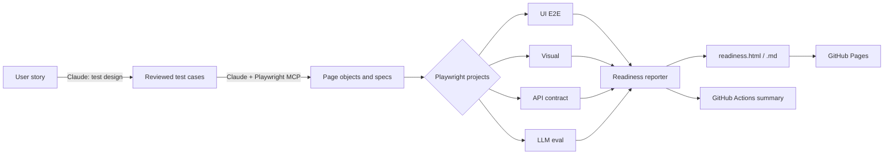

# AI-driven QA automation framework

[](https://github.com/fauzanfzn/ai-qa-automation-framework/actions/workflows/ci.yml)
[](https://fauzanfzn.github.io/ai-qa-automation-framework/readiness.html)

A Playwright + TypeScript framework that covers **UI end-to-end, visual regression, API contract and LLM chatbot evaluation** in one pipeline, and turns every run into a **QA readiness report** a team can act on.

It is a public, open version of how I work as a QA Automation Engineer: tests are designed and drafted with **Claude + Playwright MCP**, reviewed by a human, and run in CI on every push and every morning. It runs against public demo apps only ([Sauce Demo](https://www.saucedemo.com) and [Restful-Booker](https://restful-booker.herokuapp.com)); no code or data from any employer or client is included.

**Live report:** [readiness summary](https://fauzanfzn.github.io/ai-qa-automation-framework/readiness.html) · [full Playwright report](https://fauzanfzn.github.io/ai-qa-automation-framework/)

## What it covers

| Layer | Target | What is checked | Tests |
| --- | --- | --- | --- |
| UI end-to-end | Sauce Demo | Data-driven login (5 cases), catalog, sorting, cart, full checkout with price check, form validation | 11 |
| Visual regression | Sauce Demo | Login, inventory and checkout pages against approved baselines, product images masked | 3 |
| API contract | Restful-Booker | Auth, list, full CRUD lifecycle, filtering, every response validated against a zod schema, 404/403 negative cases | 9 |
| LLM evaluation | Support chatbot | Accuracy, grounding (no invented facts), prompt injection, privacy, consistency | 14 |

37 tests and 80 individual checks per run, in about 25 seconds.

## How it fits together



## How I use AI in QA

1. **Design:** Claude turns a user story into a test design table ([prompt](prompts/01-test-design-from-user-story.md)). I review coverage and remove anything that is tested twice.
2. **Build:** with the Playwright MCP server, Claude explores the app in a real browser and drafts page objects and specs that follow [CLAUDE.md](CLAUDE.md) ([prompt](prompts/02-explore-with-playwright-mcp.md)).
3. **Run:** the whole suite runs in CI on every push and daily.
4. **Triage:** Claude classifies failures and drafts tickets; I reproduce every one manually before it is reported ([prompt](prompts/03-triage-failures.md)). Automated findings are candidates, not bugs.

At work, this approach replaced manual checking with 4,800+ automated API checks per run plus E2E and visual regression, and cut full-regression effort by an estimated 90%+.

The LLM suite already proved its value while building this repo: the first run caught the bot answering a question about an unsupported destination with general shipping information instead of saying it did not know (case `GRD-01`). The bot was fixed and the case now guards against that regression.

## Readiness report

Every run writes `playwright-report/readiness.html` and `readiness.md`: readiness per area, number of checks, flaky tests, LLM results by category, and a list of blockers. The same summary appears on the GitHub Actions run page.

## Run it locally

```bash
npm ci
npx playwright install --with-deps chromium
npx playwright test                 # everything
npx playwright test --project=api   # one layer
npx playwright show-report          # open the report
```

The first run creates visual baselines (`--update-snapshots=missing`); later runs compare against them.

To evaluate a real model instead of the built-in demo bot, set `LLM_ENDPOINT` (any OpenAI-compatible `/chat/completions` URL), `LLM_API_KEY` and optionally `LLM_MODEL`.

## Project layout

```
pages/          page objects (data-test locators only)
fixtures/       test fixtures, test data, API schemas, LLM bot and eval cases
tests/ui        end-to-end flows
tests/visual    visual regression
tests/api       API contract and negative tests
tests/llm       LLM evaluation
reporters/      QA readiness reporter
prompts/        Claude prompts used to design, build and triage tests
CLAUDE.md       rules for AI agents working in this repo
```

## Author

**Muhammad Nur Fauzan** · QA Automation Engineer / SDET · [LinkedIn](https://www.linkedin.com/in/mnurfauzan-qa) · [GitHub](https://github.com/fauzanfzn)
